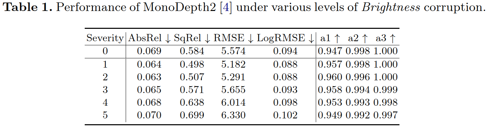
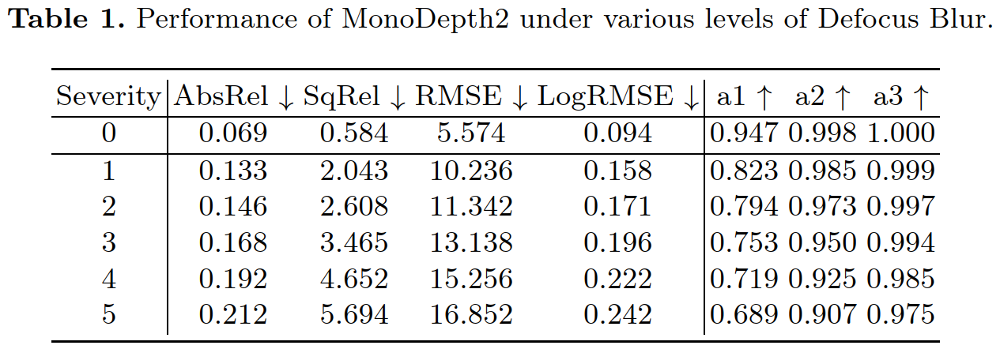
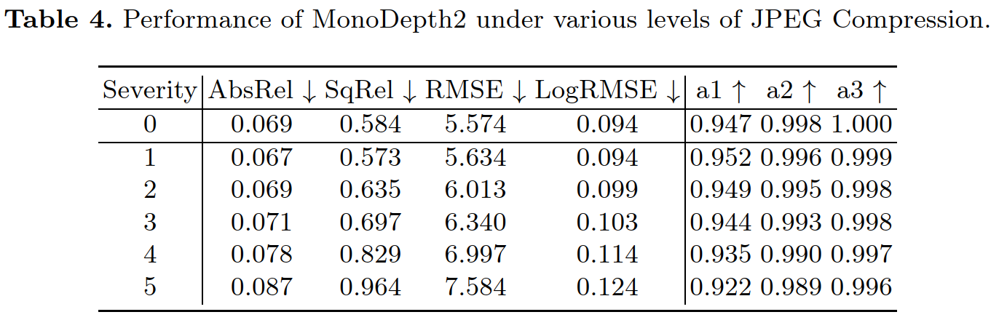
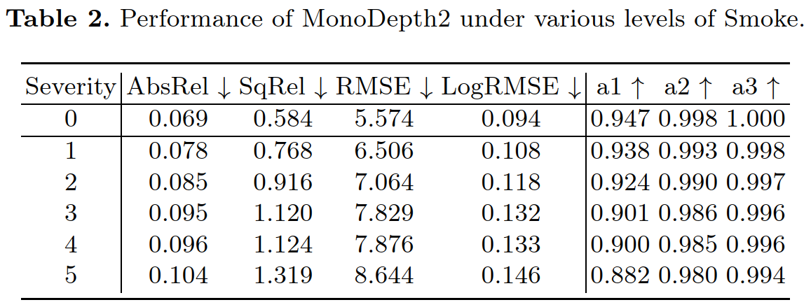
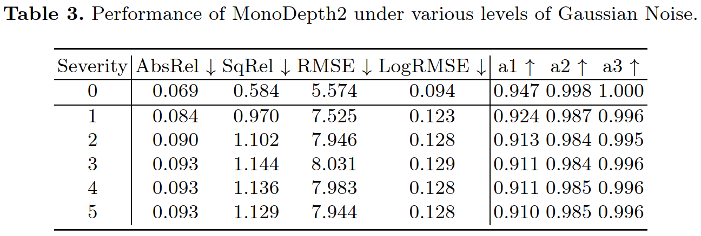

# EndoDepthBenchmark


## Introduction

Accurate depth perception is crucial for patient outcomes in endoscopic surgery, yet it is compromised by image distortions common in surgical settings. As shown in the image below, the depth estimation model's performance degrades significantly when the input image is corrupted.

<p align="center">
  
</p>

Our study introduces a benchmark for evaluating the robustness of endoscopic depth estimation models. We've compiled a dataset with synthetically induced corruptions at different intensities. We also present the Depth Estimation Robustness Score (*DERS*), a new metric combining error, accuracy, and robustness measures. This metric and benchmark aim to improve model refinement and reliability under adverse conditions. Our findings highlight the need for robust algorithms, contributing to surgical precision and patient safety.


## Corrupted Dataset

We utilize the [SCARED](https://endovissub2019-scared.grand-challenge.org/) dataset as the base dataset. We have introduced a range of synthetic corruptions to the SCARED dataset to create a new dataset, which we refer to as SCARED-C dataset. 
This expanded dataset serves as a rigorous evaluation platform for the accuracy of depth estimation within endoscopic imagery, hence serving a pivotal role in our robustness benchmarking.
The SCARED-C dataset contains 551 images, originated from the [test split](splits/scared/test_files.txt) in [AF-SfMLearner](https://github.com/ShuweiShao/AF-SfMLearner/blob/main/splits/endovis/test_files.txt). In total, **16** corruptions are applied to the images in the dataset at **5** intensities.

### Corruptions

The corruptions applied to the images are as follows:

<p align="center">
  
</p>


For more details on the corruptions, please refer to the paper *Sec. 2.1*. 


### Dataset Structure

The **SCARED-C** dataset is structured as follows:

<details>
  <summary>Click to expand!</summary>
  
  <p align="left">
  
</p>
</details>

Note that _clean_ refers to the original image without any corruptions applied.

The dataset is available at [OneDrive](https://mycuhk-my.sharepoint.com/:u:/g/personal/1155172831_link_cuhk_edu_hk/EVDt---vD7hDr8qp2HEmKvMBL9oYxtZTid5_tAfZswpD-Q?e=MQD4Oa).

### Usage
1. Install basic packages, inlcuding torch, torchvision, numpy, etc.
2. Refer to [AF-SfMLearner](https://github.com/ShuweiShao/AF-SfMLearner?tab=readme-ov-file#-datasets) to download and process the SCARED dataset.
3. Go to corruptions folder and run the following command to apply corruptions to the images. For example, to apply brightness corruption, run the following command:
```bash
python create.py --image_list <path_to_image_list> --save_path <path_to_save_corrupted_images> --if_brightness
```
Similarly, you can apply other corruptions by using the respective flags.

## Metrics

### Error and Accuracy Metrics
Commonly used error and accuracy metrics are employed to evaluate the performance of depth estimation models. The metrics used are as follows:
- Error metrics  
  - Absolute Relative Difference ($AbsRel$)
  - Squared Relative Difference ($SqRel$) 
  - Root Mean Squared Error ($RMSE$)
  - Root Mean Squared Error in Logarithmic Scale ($LogRMSE$)
- Accuracy metrics (Thresholded Accuracy) 
  - $a1$ ($\delta$ < 1.25)
  - $a2$ ($\delta$ < 1.25^2)
  - $a3$ ($\delta$ < 1.25^3)

### Depth Estimation Robustness Score (DERS)

*DERS* purposefully devised to combine three pivotal components—error, accuracy, and robustness—into a comprehensive composite index.

The *DERS* is calculated as follows:

<p align="center">
  
</p>

Here, E, A, and R are the Error Component, Accuracy Component, and Robustness Component, respectively, and can be calculated as follows:

<p align="center">
  
   
  
</p>

For more details on the *DERS* metric, please refer to the paper *Sec. 2.2*.

### Usage
DERS metric is based on error and accuracy metrics. To calculate the DERS metric, you need to first obtain the error and accuracy metrics on the clean and corrupted images. The following code snippet demonstrates how to calculate the DERS metric using the error and accuracy metrics.

<details>
  <summary>Click to expand!</summary>

  ```python
  def calculate_ders(metrics_array, accuracy_weights=None, lambd=1.0):
      """
      Calculate the DERS (Depth Estimation Robustness Score) based on the given metrics array for a specific corruption.

      Parameters:
      - metrics_array (numpy.ndarray): Array of metrics values (6 rows X 7 columns).
      Each row represents corrption level 0-5 and each column represents a different metric.
      Metric order: abs_rel, sq_rel, rmse, rmse_log, a1, a2, a3.
      - accuracy_weights (numpy.ndarray, optional): Array of weights for the accuracy component calculation. 
      Defaults to [0.5, 0.3, 0.2].
      - lambd (float, optional): Lambda parameter for the robustness component calculation. Defaults to 1.0.

      Returns:
      - ders_score (float): The calculated DERS score.

      """
      # Error component calculation
      if accuracy_weights is None:
          accuracy_weights = np.array([0.5, 0.3, 0.2])
      error_norms = metrics_array[0, :4] # Error norms for normalization (error metrics on clean images)
      mean_errors = metrics_array[1:, :4].mean(axis=0)
      normalized_errors = mean_errors / error_norms
      
      # Accuracy component calculation
      mean_accuracies = metrics_array[:, 4:].mean(axis=0)
      weighted_accuracies = mean_accuracies * accuracy_weights
      accuracy_component = np.sum(weighted_accuracies)

      # Robustness component calculation
      deviations = metrics_array[1:, :] - metrics_array[0, :]
      robustness = np.mean(np.std(deviations, axis=0))
      
      # Final DERM calculation
      ders_score = np.sum(normalized_errors) / accuracy_component * np.exp(-lambd * robustness)
      # derm_score = lambd * robustness * np.sum(normalized_errors) / accuracy_component
      
      return ders_score
  ```

</details>

## Results

<p align="center">
  
</p>

<details>
  <summary>Click to expand!</summary>
  
  <p align="center">
  
  
  
  
  
</p>
</details>


## Acknowledgements
- [SCARED](https://endovissub2019-scared.grand-challenge.org/)
- [AF-SfMLearner](https://github.com/ShuweiShao/AF-SfMLearner)
- [monodepth2](https://github.com/nianticlabs/monodepth2)
- [imagecorruptions](https://github.com/bethgelab/imagecorruptions)
- [RoboDepth](https://github.com/ldkong1205/RoboDepth)

