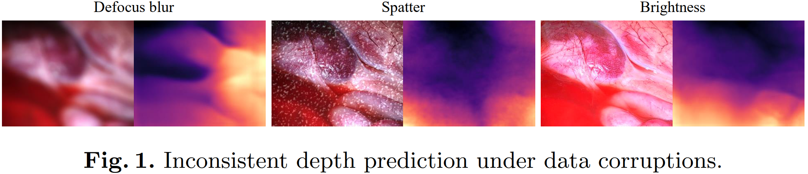
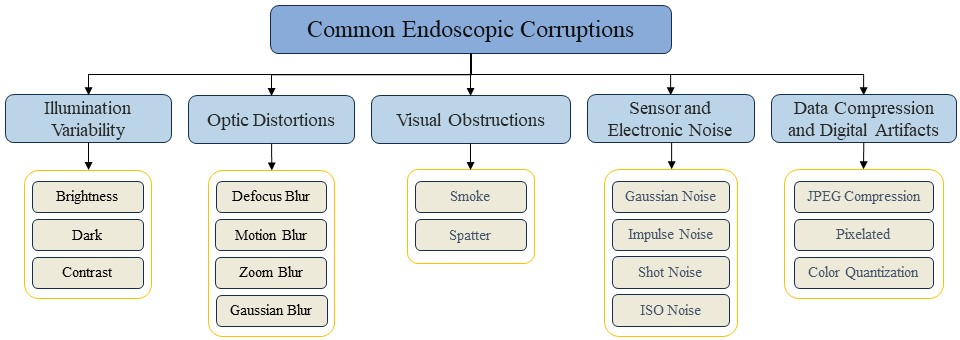
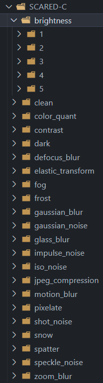
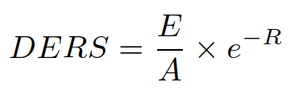
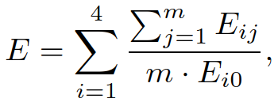
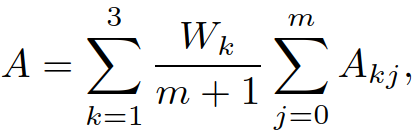
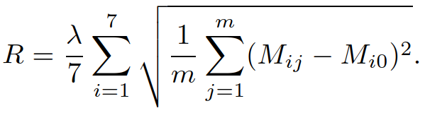
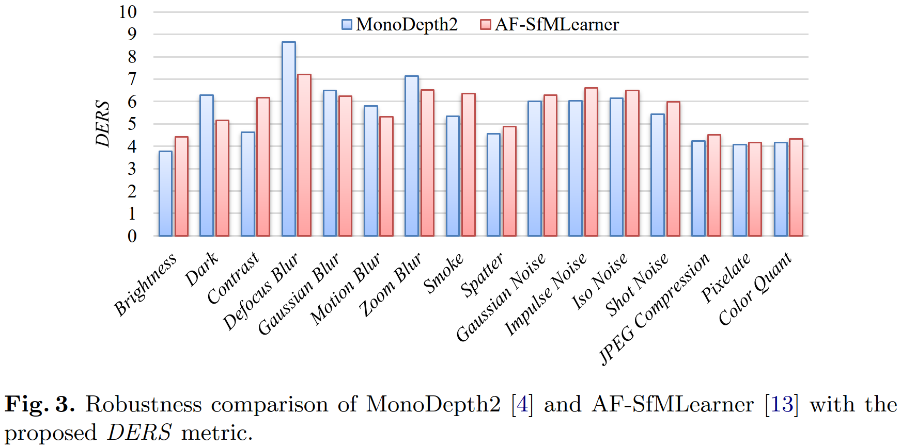

# EndoDepthBenchmark

## Introduction

Accurate depth perception is crucial for patient outcomes in endoscopic surgery, yet it is compromised by image distortions common in surgical settings. As shown in the image below, the depth estimation model's performance degrades significantly when the input image is corrupted.

  

Our study introduces a benchmark for evaluating the robustness of endoscopic depth estimation models. We've compiled a dataset with synthetically induced corruptions at different intensities. We also present the Depth Estimation Robustness Score (*DERS*), a new metric combining error, accuracy, and robustness measures. This metric and benchmark aim to improve model refinement and reliability under adverse conditions. Our findings highlight the need for robust algorithms, contributing to surgical precision and patient safety.

## Corrupted Dataset

We utilize the [SCARED](https://endovissub2019-scared.grand-challenge.org/) dataset as the base dataset. We have introduced a range of synthetic corruptions to the SCARED dataset to create a new dataset, which we refer to as SCARED-C dataset. 
This expanded dataset serves as a rigorous evaluation platform for the accuracy of depth estimation within endoscopic imagery, hence serving a pivotal role in our robustness benchmarking.
The SCARED-C dataset contains 551 images, originated from the [test split](splits/scared/test_files.txt) in [AF-SfMLearner](https://github.com/ShuweiShao/AF-SfMLearner/blob/main/splits/endovis/test_files.txt). In total, **16** corruptions are applied to the images in the dataset at **5** intensities.

### Corruptions

The corruptions applied to the images are as follows:

  

For more details on the corruptions, please refer to the paper *Sec. 2.1*. 

#### Dataset Structure

The **SCARED-C** dataset is structured as follows:

  
Click to expand!

  
  

  

Note that _clean_ refers to the original image without any corruptions applied.

## Metrics

### Accuracy and Error Metrics

### Depth Estimation Robustness Score (DERS)

*DERS* purposefully devised to combine three pivotal components—error, accuracy, and robustness—into a comprehensive composite index.

The *DERS* is calculated as follows:

  

where E, A, and R are the Error Component, Accuracy Component, and Robustness Component, respectively, and can be calculated as follows:

  
   
  

     \ metrics
level   abs_rel, sq_rel, rmse, rmse_log, a1, a2, a3
0
1
2
3
4
5

## Results

  

